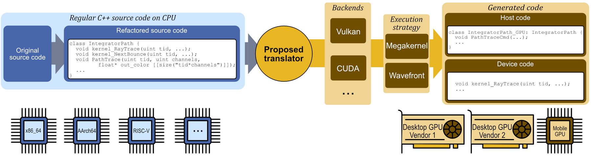
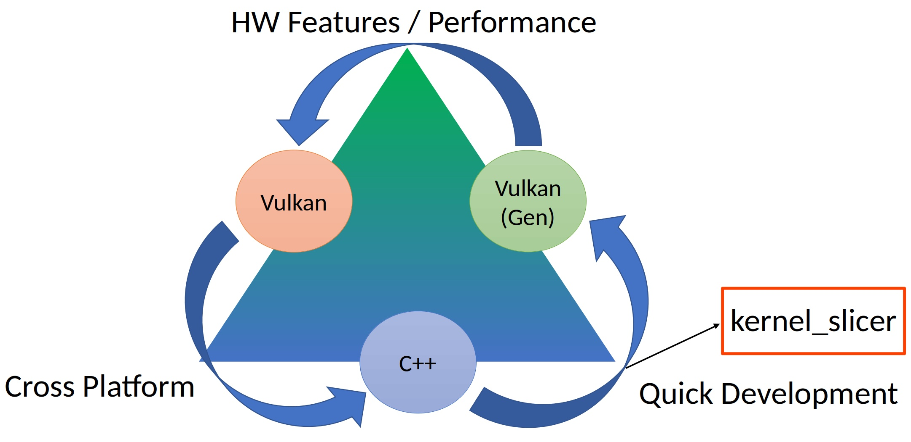
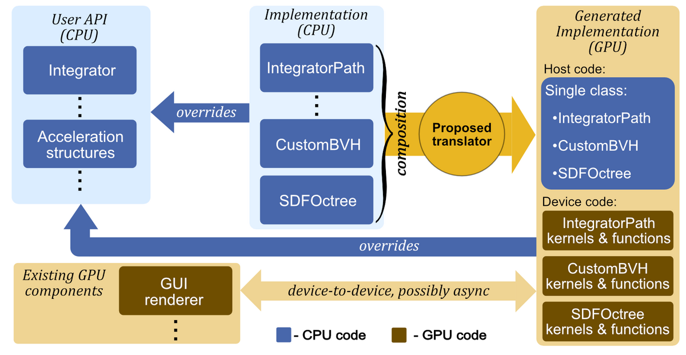

# kernel_slicer: from a plain C++ algorithm to GPU code

<p align = "center"></p>

**kernel_slicer** (`kslicer`) is a source-to-source translator built on clang. It takes an
ordinary C++ class that describes an algorithm and contains no GPU-specific code, and generates
a readable implementation of the same class for the GPU: host code in Vulkan plus shaders in Slang
or GLSL. CUDA/HIP and ISPC back ends are also available.

The input stays plain C++. It compiles with any C++ compiler and works as the reference CPU
implementation, which you write and debug as usual. Generating the hardware-accelerated version is
an automatic transformation of the program into an equivalent form for the chosen target platform.

The project is developed at the Keldysh Institute of Applied Mathematics RAS (KIAM RAS) and
Lomonosov Moscow State University.

<p align = "center"></p>
<p align = "center"><i>Workflow. The algorithm is written in C++ and remains a working CPU implementation.
The translator generates host and device code for the chosen back end and execution strategy.</i></p>

## Why

Hardware keeps getting more diverse, and every platform has its own dialect: CUDA, HIP, Metal,
Vulkan, ISPC. Porting an algorithm to new hardware takes months, and you have to do it again after
every change to the algorithm. Most existing technologies give you two of three properties:

- **hardware acceleration**: ray tracing cores, textures, indirect dispatch, subgroups;
- **cross-platform support**: NVIDIA, AMD, Intel, mobile GPUs, other vendors;
- **low development cost**.

CUDA and OptiX are tied to a single vendor. OpenCL has no access to modern hardware features.
Vulkan has everything but is many times more laborious. Dr.Jit and LuisaCompute rely on their own
runtimes and act as a black box.

kernel_slicer aims for all three properties:

- you write the algorithm once in C++, with no language extensions;
- the translator generates Vulkan code that uses hardware acceleration where it is available, and
  a software replacement where it is not (for example, a BVH traversal compiled from your own C++
  instead of hardware ray tracing);
- translation happens ahead of time, with no runtime. The result is a **white box**: a normal C++
  class plus shaders that you can read, debug with ordinary tools and extend by hand.

<p align = "center"></p>
<p align = "center"><i>Hardware features, cross-platform support and quick development: kernel_slicer
generates Vulkan code from plain C++.</i></p>

## How it works

You write a *main class* in a fixed style:

- **control functions**: public methods that call kernels in order. On the GPU they become a
  recorded command buffer;
- **kernels**: methods named `kernel1D_`, `kernel2D_`, `kernel3D_` or `kernel_`, which contain the
  parallel loop or the code of one thread. Each kernel becomes a compute shader;
- **data**: POD fields and `std::vector` fields of the class. They become a uniform buffer and
  storage buffers.

```cpp
// filter.h
class Filter
{
public:
  virtual void Run(int w, int h, const float4* a_in [[size("w*h")]], uint32_t* a_out [[size("w*h")]]);
  virtual void CommitDeviceData() {}                                        // overridden in the generated class
  virtual void GetExecutionTime(const char* a_funcName, float a_out[4]) {}  // overridden in the generated class
protected:
  virtual void kernel2D_Blur (int w, int h, const float4* a_in, float4* a_out);
  virtual void kernel2D_ToLDR(int w, int h, const float4* a_in, uint32_t* a_out);
  std::vector<float4> m_tmp;                     // an intermediate GPU buffer
};

// filter.cpp -- the file given to the translator
void Filter::Run(int w, int h, const float4* a_in, uint32_t* a_out)  // a control function: calls kernels
{
  kernel2D_Blur (w, h, a_in, m_tmp.data());
  kernel2D_ToLDR(w, h, m_tmp.data(), a_out);
}

void Filter::kernel2D_Blur(int w, int h, const float4* a_in, float4* a_out)
{
  for(int y = 0; y < h; y++)                     // these loops become the GPU thread grid
    for(int x = 0; x < w; x++)
      a_out[y*w + x] = ...;
}
```

The translator generates `Filter_Generated`, a class derived from `Filter` with the same interface.
It takes care of buffer allocation, data transfer, descriptor sets, barriers and kernel launches.
Your program switches to the GPU by replacing one pointer:

```cpp
std::shared_ptr<Filter> pImpl = onGPU ? CreateFilter_Generated(ctx, w*h) : std::make_shared<Filter>();
pImpl->CommitDeviceData();
pImpl->Run(w, h, input.data(), output.data());
```

To hand-optimize a particular kernel, override it in your own class derived from the generated one.
Regenerating the code does not overwrite your changes. For example, a 64-line tone mapping filter
turns into about 1400 lines of host code and shaders.

Large programs are built from several classes by inheritance and composition. The translator
merges them into a single generated class, and the generated code can exchange data with existing
GPU components on the device without copying to the CPU.

<p align = "center"></p>
<p align = "center"><i>Inheritance and composition in the design of a rendering system. The user API and the CPU
implementation are ordinary C++ classes; the generated GPU class overrides the same interface.</i></p>

## Documentation

- [Build](doc/build.md): requirements, Linux, Windows, libraries for the samples
- [Quick start](doc/quick_start.md): translate, build and run a complete sample
- [Patterns, execution strategies and back ends](doc/concepts.md): IPV, RTV, BEV, ray tracing, megakernel
- [Feature status](doc/features.md): what is supported by each back end, with tests and samples
- [Writing code for kernel_slicer](doc/writing_code.md): rules for the input code, AI assistants, older tutorials
- [Translator options and config files](doc/options.md): command line options and `kmake.json`
- [Tests and repository layout](doc/development.md): running `ktest.py`, structure of the repository
- [Troubleshooting](doc/troubleshooting.md)
- [Internal documentation](doc/internals.md): passes of the translator (partly outdated); for changes to
  the translator itself see [AGENTS.md](AGENTS.md)

## Publications

1. Frolov V., Sanzharov V., Galaktionov V. kernel_slicer: high-level approach on top of GPU
   programming API // 2022 Ivannikov Ispras Open Conference (ISPRAS). 2022. P. 11–17.
   [IEEE Xplore](https://ieeexplore.ieee.org/document/10076850/),
   doi:[10.1109/ISPRAS57371.2022.10076850](https://doi.org/10.1109/ISPRAS57371.2022.10076850)

## Acknowledgments

We thank the developers of clang for the excellent structure and documentation of their front end,
on which this project is built.

## License

[MIT](LICENSE)
