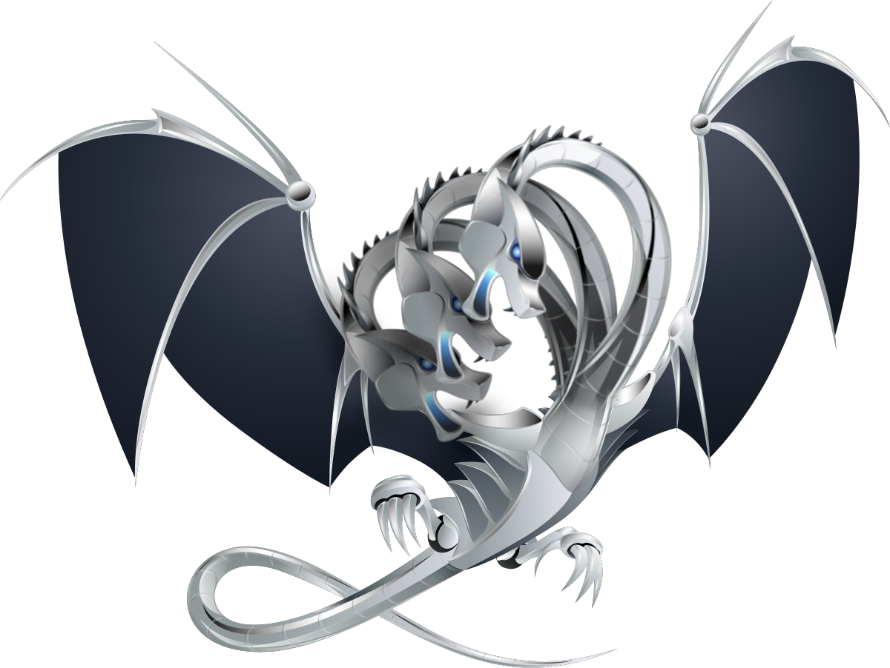
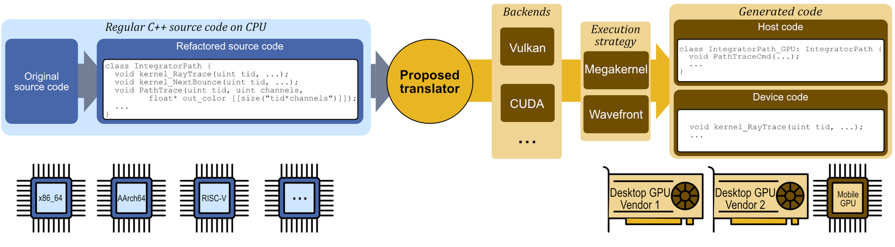
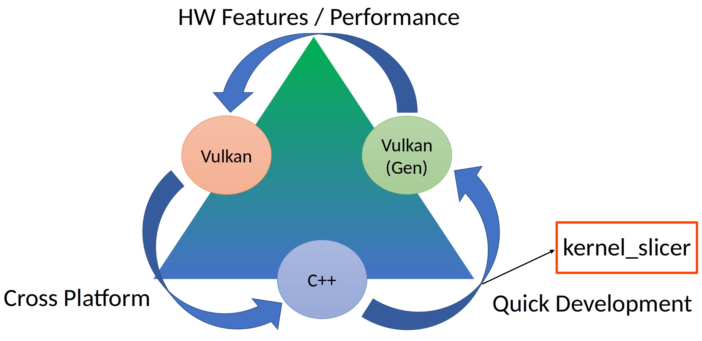
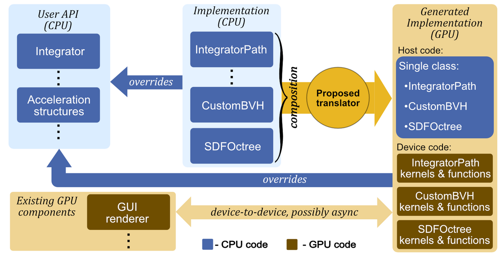

# kernel_slicer: from a plain C++ algorithm to GPU code

<p align = "center"></p>

**kernel_slicer** (`kslicer`) is a source-to-source translator built on clang. It takes an
ordinary C++ class that describes an algorithm and contains no GPU-specific code, and generates
a readable implementation of the same class for the GPU: host code in Vulkan plus shaders in Slang
or GLSL. CUDA/HIP and ISPC back ends are also available.

The input stays plain C++. It compiles with any C++ compiler and works as the reference CPU
implementation, which you write and debug as usual. Generating the hardware-accelerated version is
an automatic transformation of the program into an equivalent form for the chosen target platform.

The project is developed at the Keldysh Institute of Applied Mathematics RAS (KIAM RAS) and
Lomonosov Moscow State University.

<p align = "center"></p>
<p align = "center"><i>Workflow. The algorithm is written in C++ and remains a working CPU implementation.
The translator generates host and device code for the chosen back end and execution strategy.</i></p>

## Why

Hardware keeps getting more diverse, and every platform has its own dialect: CUDA, HIP, Metal,
Vulkan, ISPC. Porting an algorithm to new hardware takes months, and you have to do it again after
every change to the algorithm. Most existing technologies give you two of three properties:

- **hardware acceleration**: ray tracing cores, textures, indirect dispatch, subgroups;
- **cross-platform support**: NVIDIA, AMD, Intel, mobile GPUs, other vendors;
- **low development cost**.

CUDA and OptiX are tied to a single vendor. OpenCL has no access to modern hardware features.
Vulkan has everything but is many times more laborious. Dr.Jit and LuisaCompute rely on their own
runtimes and act as a black box.

kernel_slicer aims for all three properties:

- you write the algorithm once in C++, with no language extensions;
- the translator generates Vulkan code that uses hardware acceleration where it is available, and
  a software replacement where it is not (for example, a BVH traversal compiled from your own C++
  instead of hardware ray tracing);
- translation happens ahead of time, with no runtime. The result is a **white box**: a normal C++
  class plus shaders that you can read, debug with ordinary tools and extend by hand.

<p align = "center"></p>
<p align = "center"><i>Hardware features, cross-platform support and quick development: kernel_slicer
generates Vulkan code from plain C++.</i></p>

## How it works

You write a *main class* in a fixed style:

- **control functions**: public methods that call kernels in order. On the GPU they become a
  recorded command buffer;
- **kernels**: methods named `kernel1D_`, `kernel2D_`, `kernel3D_` or `kernel_`, which contain the
  parallel loop or the code of one thread. Each kernel becomes a compute shader;
- **data**: POD fields and `std::vector` fields of the class. They become a uniform buffer and
  storage buffers.

```cpp
// filter.h
class Filter
{
public:
  virtual void Run(int w, int h, const float4* a_in [[size("w*h")]], uint32_t* a_out [[size("w*h")]]);
  virtual void CommitDeviceData() {}                                        // overridden in the generated class
  virtual void GetExecutionTime(const char* a_funcName, float a_out[4]) {}  // overridden in the generated class
protected:
  virtual void kernel2D_Blur (int w, int h, const float4* a_in, float4* a_out);
  virtual void kernel2D_ToLDR(int w, int h, const float4* a_in, uint32_t* a_out);
  std::vector<float4> m_tmp;                     // an intermediate GPU buffer
};

// filter.cpp -- the file given to the translator
void Filter::Run(int w, int h, const float4* a_in, uint32_t* a_out)  // a control function: calls kernels
{
  kernel2D_Blur (w, h, a_in, m_tmp.data());
  kernel2D_ToLDR(w, h, m_tmp.data(), a_out);
}

void Filter::kernel2D_Blur(int w, int h, const float4* a_in, float4* a_out)
{
  for(int y = 0; y < h; y++)                     // these loops become the GPU thread grid
    for(int x = 0; x < w; x++)
      a_out[y*w + x] = ...;
}
```

The translator generates `Filter_Generated`, a class derived from `Filter` with the same interface.
It takes care of buffer allocation, data transfer, descriptor sets, barriers and kernel launches.
Your program switches to the GPU by replacing one pointer:

```cpp
std::shared_ptr<Filter> pImpl = onGPU ? CreateFilter_Generated(ctx, w*h) : std::make_shared<Filter>();
pImpl->CommitDeviceData();
pImpl->Run(w, h, input.data(), output.data());
```

To hand-optimize a particular kernel, override it in your own class derived from the generated one.
Regenerating the code does not overwrite your changes. For example, a 64-line tone mapping filter
turns into about 1400 lines of host code and shaders.

Large programs are built from several classes by inheritance and composition. The translator
merges them into a single generated class, and the generated code can exchange data with existing
GPU components on the device without copying to the CPU.

<p align = "center"></p>
<p align = "center"><i>Inheritance and composition in the design of a rendering system. The user API and the CPU
implementation are ordinary C++ classes; the generated GPU class overrides the same interface.</i></p>

## Features

**Architectural patterns.** The pattern is chosen per kernel by its name prefix, and one class
may mix them.
- **IPV** (Image Processing Vectorization): `kernel1D_/2D_/3D_` kernels with 1–3 nested `for` loops,
  i.e. a "parallel for". Use it for image filters, simulations, reductions, stencils, and also for
  ray marching or ray tracing with a bounded number of bounces.
- **RTV** (Ray Tracing Vectorization): `kernel_` kernels written as the code of one thread, which
  pass per-thread state (payload) between stages. Use it for path tracing and other multi-stage
  pipelines whose threads finish at different times.
- **BEV** (Block Expansion Vectorization), **experimental**: `kernelBE1D_` kernels for algorithms
  that work on blocks of data in a work group with shared memory. See below.

**Block Expansion Vectorization (experimental).** The kernel is a template on the block size. The
outer loop runs over blocks, and each block becomes one work group of `bsize` threads. Local arrays
declared in the block body are placed in shared memory. Loops marked `[[parallel]]` are executed by
all threads of the work group, one iteration per thread. Other statements are executed by one
thread. Barriers are inserted between these parts automatically.

```cpp
template<uint bsize>
void TestClass::kernelBE1D_Test(uint blockNum, float* out_buffer)
{
  for(uint blockId = 0; blockId < blockNum; blockId++)              // one work group per block
  {
    float blockData[bsize];                                          // shared memory

    for(int localId = 0; localId < bsize; localId++) [[parallel]]    // all threads of the group
      blockData[localId] = float(localId + blockId);

    blockData[5] = 5.0f;                                             // one thread

    for(int localId = 0; localId < bsize; localId++) [[parallel]]
      out_buffer[blockId*bsize + localId] = blockData[localId];
  }
}

// in a control function: the template argument sets the work group size
kernelBE1D_Test<64>(numElements/64, out_buffer);
```

Only 1D kernels are supported. The feature works with the Slang and GLSL back ends and is covered
by a single test, `apps/tests/030_block_expansion_v1`.

**Algorithmic patterns recognized in the code:**
- parallel reduction to a class member (sum, min, max), including over arrays;
- prefix sum (`std::exclusive_scan`, `std::inclusive_scan`) and sorting (`std::sort` with a lambda);
- `memcpy` between buffers;
- appending to an array (`m_vec.push_back` inside a kernel) and indirect dispatch whose size is
  computed on the GPU;
- atomics, including float atomics, with a CAS emulation option for GPUs that lack them;
- hash tables (`std::unordered_map` fields of the class);
- textures and samplers;
- virtual functions;
- ray tracing queries through an abstract scene interface.

**Cross-platform hardware acceleration for ray tracing.** User code traces rays through an
abstract scene interface ([CrossRT](https://github.com/msu-graphics-group/CrossRT), the
`apps/RayTracing` submodule). On the CPU it may be implemented with Embree. On the GPU the
translator generates either Vulkan hardware ray tracing or a software BVH traversal compiled from
C++. Custom primitives (SDF, NURBS and others) are defined by a C++ intersection function, which is
embedded into both traversal variants.

**Execution strategies from one source**, selected with translator options: one megakernel or a
set of separate kernels with automatic layout of per-ray data in memory, and ray reordering, where
a thread group processes one pixel to reduce divergence. These variants differ in their kernels,
resources and host code. Maintaining them by hand is impractical; here you switch an option.

**Back ends** (`-shaderCC`):

| Value | Output | Status |
|-------|--------|--------|
| `slang` | Vulkan host code + Slang shaders (`slangc` → SPIR-V) | **main, recommended** |
| `glsl`  | Vulkan host code + GLSL shaders (`glslangValidator`) | legacy, maintained |
| `cuda` / `hip` / `musa` | CUDA, HIP, MUSA | experimental |
| `ispc`  | CPU vectorization with Intel ISPC | experimental |
| `wgpu`  | WebGPU | experimental |
| `clspv` | OpenCL C → SPIR-V via clspv (the built-in default) | outdated, always set `-shaderCC` explicitly |

## Build

Requirements: CMake ≥ 3.8, a C++17 compiler, **LLVM/clang 17** (development libraries), and the
[Vulkan SDK](https://vulkan.lunarg.com/sdk/home), which provides `slangc` and `glslangValidator`.

```bash
git clone --recurse-submodules https://github.com/Ray-Tracing-Systems/kernel_slicer
cd kernel_slicer
# if cloned without submodules: git submodule update --init
```

### Linux with apt (Ubuntu, Debian)

```bash
wget https://apt.llvm.org/llvm.sh && chmod +x llvm.sh && sudo ./llvm.sh 17
sudo apt install llvm-17-dev libclang-17-dev clang-17
sudo touch /usr/lib/llvm-17/bin/yaml-bench

mkdir cmake-build-release && cd cmake-build-release
cmake -DCMAKE_BUILD_TYPE=Release ..
make -j 10
```

### Other Linux distributions (Manjaro, Arch, ...)

Use the prebuilt LLVM 17 from the LLVM releases and build kslicer with its clang:

```bash
curl -LO https://github.com/llvm/llvm-project/releases/download/llvmorg-17.0.6/clang+llvm-17.0.6-x86_64-linux-gnu-ubuntu-22.04.tar.xz
sudo mkdir -p /opt/llvm17
sudo tar -xf clang+llvm-17.0.6-x86_64-linux-gnu-ubuntu-22.04.tar.xz -C /opt/llvm17 --strip-components=1
sudo touch /opt/llvm17/bin/yaml-bench

cd kernel_slicer
mkdir cmake-build-release && cd cmake-build-release
cmake -S .. -B . \
      -DCMAKE_BUILD_TYPE=Release \
      -DCMAKE_C_COMPILER=clang -DCMAKE_CXX_COMPILER=clang++ \
      -DCMAKE_CXX_FLAGS="-include cstdint -fno-rtti" \
      -DLLVM_DIR=/opt/llvm17/lib/cmake/llvm \
      -DClang_DIR=/opt/llvm17/lib/cmake/clang
make -j 10
```

### Windows

1. Build LLVM 17 with clang ([instructions](https://llvm.org/docs/GettingStarted.html#getting-the-source-code-and-building-llvm)):
   ```
   git clone --branch release/17.x --depth=1 https://github.com/llvm/llvm-project.git
   cd llvm-project
   cmake -S llvm -B build -G "Visual Studio 17 2022" -DLLVM_ENABLE_PROJECTS="clang" -DCMAKE_BUILD_TYPE=Release
   ```
   Open `build/LLVM.sln` and build the Release configuration. If the build stops because the
   compiler runs out of heap memory, start it again: it continues from where it stopped.
2. Build kernel_slicer:
   ```
   mkdir cmake-build-release && cd cmake-build-release
   cmake -DLLVM_DIR=..\llvm-project\build\lib\cmake\llvm -DClang_DIR=..\llvm-project\build\lib\cmake\clang -DCMAKE_BUILD_TYPE=Release ..
   ```
   Open `kernel_slicer.sln` and build the Release configuration.

You can also [build kslicer as part of LLVM](doc/README_build_with_llvm.md).

### Libraries for the samples

```bash
cd apps/volk && cmake . && make && cd ../..   # Vulkan loader used by all samples
sudo apt install libfreeimage-dev libglfw3-dev  # needed by some samples only
```

## Quick start

A complete sample is `apps/30_metaballs`, a ray tracer of metaballs with reflections written in the
IPV pattern. Translate it, compile the shaders, then build and run:

```bash
cd apps/30_metaballs
../../cmake-build-release/kslicer $PWD/kmake.json -selfdir $PWD/../..
cd shaders_generated && bash build_slang.sh && cd ..
cmake -S . -B build_release -DCMAKE_BUILD_TYPE=Release && cmake --build build_release -j 8

./build_release/testapp             # CPU version  -> zout_cpu.bmp
./build_release/testapp --gpu       # GPU version  -> zout_gpu.bmp
./build_release/testapp --compare   # both, timings and image difference
```

kslicer loads its code templates relative to the current directory. Run it from the repository
root, or pass `-selfdir <repository root>` as above.

The same translation without a config file:

```bash
./cmake-build-release/kslicer apps/30_metaballs/metaballs.cpp -mainClass Metaballs \
    -stdlibfolder TINYSTL -Iapps/LiteMath ignore -Iapps/LiteMathAux ignore -ITINYSTL ignore \
    -shaderCC slang -reorderLoops YX -DKERNEL_SLICER -v
```

The generated files are named after the input file: `metaballs_generated.h`,
`metaballs_generated.cpp`, `metaballs_generated_ds.cpp`, `metaballs_generated_init.cpp` and the
`shaders_generated/` folder.

## Translator options

Most frequently used options; the full list is in [doc/README_options.md](doc/README_options.md).

| Option | Meaning |
|--------|---------|
| `-mainClass Name` | Class to translate |
| `-shaderCC slang` | Back end, see the table in [Features](#features). Always set it: the built-in default is the outdated `clspv` |
| `-stdlibfolder TINYSTL` | Minimal standard library used for parsing |
| `-I<dir> ignore` | Headers from `<dir>` are used for parsing only (LiteMath, TINYSTL) |
| `-I<dir> process` | Functions and types from headers in `<dir>` are translated into shaders |
| `-DNAME` | Preprocessor define for parsing. `KERNEL_SLICER` is always defined during translation, so `#ifndef KERNEL_SLICER` hides CPU-only code from the translator |
| `-reorderLoops YX` | For 2D kernels written with `y` outer and `x` inner: makes `x` the fastest thread index. Always use it for images |
| `-megakernel 1` | Each RTV control function becomes one shader instead of a sequence of kernels |
| `-enable_ray_tracing_pipeline 1` | With `-megakernel 1`: use the Vulkan ray tracing pipeline instead of ray queries |
| `-timestamps 1` | GPU time of every kernel through `GetExecutionTime("kernel2D_Name", t)` |
| `-atomicf_emul 1` | Emulate float atomics with CAS on GPUs without `shaderBufferFloat32AtomicAdd` (Slang) |
| `-suffix _GPU` | Name of the generated class, factory function and shader folder (default `_Generated`) |
| `-selfdir <dir>` | Repository root, when kslicer is not started from it |

Complete command lines for every sample and test are in `.vscode/launch_slang.json` and
`.vscode/launch_glsl.json`.

## Config files

Instead of a long command line, keep the settings in a JSON config next to the sample and pass it
to kslicer instead of the source file. Paths in the config are relative to it; options given on
the command line override the config.

```jsonc
{
  "mainClass" : "Metaballs",
  "source"    : ["metaballs.cpp"],
  "kernels"   : {
    "kernel2D_Trace" : {"wgSize": [8, 8, 1]}       // per-kernel work group size
  },
  "options" : {                                    // any command line options
    "-shaderCC"     : "slang",
    "-reorderLoops" : "YX",
    "-timestamps"   : "1"
  },
  "includeProcess" : [],                           // like -I<dir> process
  "includeIgnore"  : ["../LiteMath", "../LiteMathAux", "../../TINYSTL"]  // like -I<dir> ignore
}
```

```bash
cd apps/30_metaballs
../../cmake-build-release/kslicer $PWD/kmake.json -selfdir $PWD/../..
```

A config can also list base classes of the main class (`baseClasses`), describe composition with a
ray tracing scene and custom intersection functions (`composClasses`), set defines and default work
group sizes, and groups of member vectors for `CommitAppendedData()` (`appendGroups`), which copies
only appended elements to GPU instead of a full `CommitDeviceData()`. A sample may keep several configs for different variants, for example
`apps/tests/042_atomic_add_float/kmake_hw.json` and `kmake_emul.json`. All keys are described in
[doc/README_options.md](doc/README_options.md#config-file-kmakejson).

## Writing code for kernel_slicer

The translator supports a subset of C++. In brief:

- Every pointer argument of a control function has a size annotation `[[size("expr")]]`. `const`
  pointers are inputs and non-`const` pointers are outputs.
- All intermediate buffers are `std::vector` fields of the class, sized before `CommitDeviceData()`.
- Kernels must not call kernels, and control functions must not call control functions.
- Kernels must not allocate memory, do I/O, throw exceptions, use recursion or pointer fields.
- Use the vector types and functions of [LiteMath](https://github.com/msu-graphics-group/LiteMath)
  (`float4`, `float4x4`, `dot`, `normalize`, ...).
- Debug on the CPU first, then translate and compare CPU and GPU results.

The rules, templates of `main.cpp`/`CMakeLists.txt`/`kmake.json`, common mistakes and a map of
samples are in [`.claude/skills/kernel-slicer/SKILL.md`](.claude/skills/kernel-slicer/SKILL.md).
This file is written for LLM agents but reads as an ordinary guide.

Older tutorials, partly outdated (they use the clspv back end): [bloom filter (IPV)](doc/README_ex05.md),
[single kernel (RTV)](doc/README_ex00.md), [passing data between kernels](doc/README_ex01.md),
[path tracing with loop break](doc/README_ex03.md), [glue code and overriding generated
code](doc/README_glue.md).

## AI assistants

The input language is ordinary C++, so the approach works well with coding assistants.
The repository contains:

- [`.claude/skills/kernel-slicer/`](.claude/skills/kernel-slicer/): a skill for LLM agents that
  write programs for kernel_slicer, covering both patterns, the host code, building and verification.
  Claude Code loads it automatically when working in this repository. The `apps/30_metaballs` and
  `apps/ai_generated` samples were written with it;
- [`AGENTS.md`](AGENTS.md): instructions for agents that work on the translator itself (building,
  testing, code structure).

## Tests

Tests are in `apps/tests/` (one feature per test) and the test applications in `apps/`. Each folder
has `ktest.json` with the list of variants (back-end, `kmake.json` config, options). Build kslicer,
then run from the repository root (Python 3 standard library only, Linux and Windows):

```bash
python3 ktest.py                          # menu: back-ends, tests or applications, number of jobs
python3 ktest.py -b slang,glsl -s all     # without questions
python3 ktest.py --rerun-failed --write-launch   # rerun failed ones, write .vscode/launch_failed.json
```

For every variant it prints `[generation|build|comparison with CPU]` statuses, for example
`[ OK | OK | OK ] test_023_prefix_summ/slang`. Folders are processed in parallel and build folders
are reused, so a repeated run is fast. See [python_scripts/ktest/README.md](python_scripts/ktest/README.md).

The old test runner is still available. It reads translator command lines from `.vscode/launch.json`:

```bash
cp .vscode/launch_slang.json .vscode/launch.json      # choose the set of configurations
cd python_scripts
python3 -m venv venv && source venv/bin/activate
pip3 install -r requirements.txt
python3 gen_sample_list.py                            # writes sample_names.json; edit it to choose tests
bash run_tests.bat
```

For each configuration the runner translates the sample, compiles the shaders and the application,
runs CPU and GPU versions and compares their `zout_*` outputs. Logs of failed tests are written to
`LOG_DIR/`. See [python_scripts/README.md](python_scripts/README.md) for details.

## Repository layout

| Path | Contents |
|------|----------|
| `*.cpp`, `*.h` in the root | the translator: AST analysis, kernel and host code generation |
| `shaders_<backend>.cpp`, `tr_host_<backend>.cpp` | shader and host code generators of each back end |
| `templates/` | Vulkan host code templates ([inja](https://github.com/pantor/inja)) |
| `templates_slang/`, `templates_glsl/`, `templates_cuda/`, `templates_ispc/`, `templates_wk/` | shader and back end templates |
| `TINYSTL/` | minimal standard library used for parsing |
| `apps/` | samples; `apps/tests/` feature tests |
| `apps/LiteMath`, `apps/vkutils`, `apps/volk`, `apps/LiteScene`, `apps/RayTracing` | submodules: math library, Vulkan helpers, loader, scene loading, ray tracing interface |
| `ktest.py`, `python_scripts/ktest/` | test system; `python_scripts/tests.py` is the old test runner |
| `doc/` | older tutorials and [internal documentation](doc/README_internal.md) |

## Troubleshooting

- **kslicer finished, but the sample does not work.** kslicer returns a non-zero exit code when it
  reports an error, but not every problem is an error. Save the log and check it for `error:` and
  warnings. Then check the output of `build_slang.sh`: a pattern violation often shows up only as a
  shader compile error.
- **`no member named 'X' in namespace 'std'`.** kslicer parses with its own minimal standard
  library in `TINYSTL/`. Use an available function, for example `std::abs` instead of `std::fabs`,
  or add a declaration to `TINYSTL/`: an interface is enough.
- **A function is missing from the generated code.** It does not match a pattern. Check the kernel
  name prefix, the loop shape, and that the control function calls a kernel.
- **kslicer can not find `stddef.h`.** clang can not find its own headers. Copy them next to the
  repository: `mkdir ../lib && cp -r /usr/lib/clang/ ../lib`.
- **`can't open file shaders_generated/....spv` at start.** A shader did not compile. Run
  `build_slang.sh` and read its errors.
- **kslicer fails at step (7) with `basic_ios::clear: iostream error`.** It can not find its
  templates. Run it from the repository root or pass `-selfdir`.

## Publications

1. Frolov V., Sanzharov V., Galaktionov V. kernel_slicer: high-level approach on top of GPU
   programming API // 2022 Ivannikov Ispras Open Conference (ISPRAS). 2022. P. 11–17.
   doi:[10.1109/ISPRAS57371.2022.10076850](https://doi.org/10.1109/ISPRAS57371.2022.10076850)
2. Frolov V. A., Galaktionov V. A. From algorithm to hardware without pain: automatic generation of
   high-performance compute kernels from plain C++ // Graphicon 2026 (to appear).

## Acknowledgments

We thank the developers of clang for the excellent structure and documentation of their front end,
on which this project is built.

## License

[MIT](LICENSE)

## Build (old instructions)

1. git clone --recurse-submodules https://github.com/Ray-Tracing-Systems/kernel_slicer
  * otherwise execute after clone:
  * git submodule init
  * git submodule update

### Linux:
2. install llvm-17 (both dev and not dev)
 * wget https://apt.llvm.org/llvm.sh
 * chmod +x llvm.sh
 * sudo ./llvm.sh 17
 * sudo apt-get install llvm-17-dev
 * sudo touch /usr/lib/llvm-17/bin/yaml-bench 
 * sudo apt-get install libclang-17-dev 
 * sudo apt install clang-17

3. use Cmake and make:
  * cd kernel_slicer
  * mkdir cmake-build-release && cd cmake-build-release
  * cmake -DCMAKE_BUILD_TYPE=Release .. 
  * make -j 10
    
### Windows:
2. Getting the source code and building LLVM:
 * Follow these instructions: https://llvm.org/docs/GettingStarted.html#getting-the-source-code-and-building-llvm
 * Be sure to add clang to the configuration: -DLLVM_ENABLE_PROJECTS="clang"
 * Example:
   * git clone --branch release/17.x --depth=1 https://github.com/llvm/llvm-project.git
   * cd llvm-project
   * cmake -S llvm -B build -G "Visual Studio 17 2022" -DLLVM_ENABLE_PROJECTS="clang" -DCMAKE_BUILD_TYPE=Release
   * Open the solution "llvm-project\build\LLVM.sln" and compile the release.
   * The build may end in partial failure due to a lack of heap. Some of it has already been compiled. We try again, it should work.

3. use Cmake and VS:
  * cd kernel_slicer
  * mkdir cmake-build-release && cd cmake-build-release
  * cmake -DLLVM_DIR=..\llvm-project\build\lib\cmake\llvm -DClang_DIR=..\llvm-project\build\lib\cmake\clang -DCMAKE_BUILD_TYPE=Release ..
  * Open the solution "kernel_slicer\cmake-build-release\kernel_slicer.sln" and compile the release.
    
### We continue:

4. you may also use provided VS Code config to build and run test cases (tasks.json and launch.json)

5. Install Vulkan SDK (https://vulkan.lunarg.com/sdk/home)

6. (optional) build [google clspv](https://github.com/google/clspv "Clspv is a prototype compiler for a subset of OpenCL C to Vulkan compute shaders") if you want OpenCL shaders

7. (optional) install [intel ispc](https://ispc.github.io/ "Intel® Implicit SPMD Program Compiler") if you are going to vectorize code for CPU

8. (optional) If you want to [build it as a part of llvm](doc/README_build_with_llvm.md)
